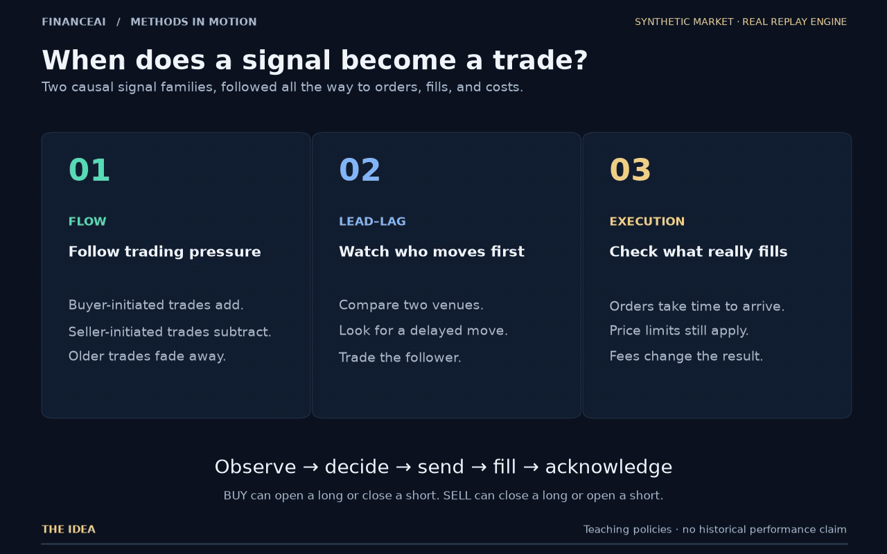
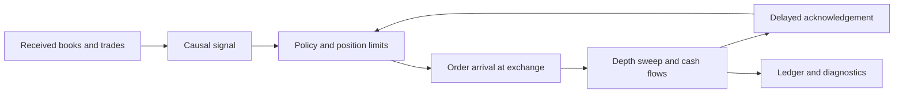

# FinanceAI

**Understand how a trading signal becomes an executable trade.**

[](https://github.com/daniil-777/tradingMathToys/actions/workflows/ci.yml)


FinanceAI is a Python library for causal market replay, execution-aware labels, and reproducible
strategy research. Configure your instruments, quantities, currencies, fees, and timing; the same
engine handles **spot, linear, and inverse contracts**.



**Watch:** [55-second movie](docs/assets/trading/trading-methods.mp4) ·
[Explanation and transcript](docs/trading_animation.md) · [Verified numerical trace](docs/assets/trading/trace.json)

The animation uses invented markets and actual replay results. It explains two signal families,
including a failed fill and a trade that predicts the direction correctly but loses after fees.

[Quickstart](#quickstart) · [Your market](#configure-your-market) · [Documentation](docs/README.md) ·
[Contributing](CONTRIBUTING.md)

## What you can study

- **Causal signals:** lead–lag, decayed trade flow, order-flow imbalance, sweeps, and linear forecasts.
- **Execution:** marketable IOC orders, price limits, displayed depth, partial fills, consumed liquidity,
  order latency, and delayed acknowledgements.
- **Accounting:** instrument-specific cash flows, proportional and per-quantity commissions,
  position caps, terminal-flat settlement, and separate results for different currencies.
- **Evaluation:** executable labels, position/PnL charts, walk-forward analysis, block bootstrap,
  multiple-comparison diagnostics, and explicit hindsight benchmarks.
- **Reproducibility:** immutable caches, strict JSON configuration, exported orders and fills,
  reference implementations, and rational-arithmetic settlement checks.

NumPy is the only required runtime dependency. Numba acceleration, plots, and the local HTTP
research service are optional.

## Quickstart

Use Python **3.12**:

```bash
git clone https://github.com/daniil-777/tradingMathToys.git
cd tradingMathToys
python3.12 -m venv .venv
source .venv/bin/activate
python -m pip install -e .
python examples/market_replay.py --market linear --out runs/linear-demo
```

The example generates synthetic books, writes reusable caches, runs a strategy, and exports
`summary.json`, `strategy.json`, `orders.csv`, and `fills.csv`. No credentials or downloads are needed.
The summary preserves the full instrument definitions and execution scenario, including fees,
acknowledgement delay, depth-consumption lifetime, and the actual risk limits. Use a new output directory for each run.

Try the same workflow with other settlement conventions:

```bash
python examples/market_replay.py --market spot --out runs/spot-demo
python examples/market_replay.py --market inverse --out runs/inverse-demo
```

Optional capabilities:

```bash
python -m pip install -e '.[fast,report]'  # compiled kernels and charts
python -m pip install -e '.[api]'         # local research job service
```

`FINANCEAI_DISABLE_JIT=1` selects the Python kernel path. The first compiled run includes Numba
compilation time. This repository is the installation source; a PyPI release is not assumed.

## Configure your market

Prices and sizes enter the engine as **integer ticks and quantity units**. The instrument definition
converts those integers into native quantities and settlement cash.

```python
from decimal import Decimal
from financeai.domains.market import ContractType, InstrumentSpec, Scenario

instrument = InstrumentSpec(
    venue="example_exchange",
    symbol="SHARE-CHF",
    contract_type=ContractType.SPOT,
    tick_size=Decimal("0.01"),
    quantity_step=Decimal("0.001"),  # 1,000 stored units = one share
    lot_size=1,                     # executable multiples of stored units
    base_currency="SHARE",
    quote_currency="CHF",
)

scenario = Scenario(
    name="my_execution_model",
    fees={instrument.key: Decimal("0.0002")},
    fees_per_unit={instrument.key: Decimal("0.005")},  # CHF per native share
    order_latency_ns=3_000_000,
    ack_latency_ns=2_000_000,
)
```

Use `Scenario.latency_by_instrument` for different order/acknowledgement delays per instrument,
and `RiskLimits(per_instrument={instrument.key: 2_000})` for different position caps. Zero caps
disable individual instruments. The [instrument guide](docs/instruments.md#instrument-specific-caps-and-delays)
shows Python and JSON configuration, including `--risk-file` for CLI runs.

These costs are illustrative configuration values. Set them to the execution conditions you want
to evaluate. Spot shorting defaults to disabled; enable `shortable=True` only when the model should
allow borrowed inventory.

| Contract convention | Typical use | Settlement | Exposure conversion |
| --- | --- | --- | --- |
| `SPOT` | Shares, currencies, digital assets | Quote currency | Quantity × price |
| `LINEAR` | Futures, linear swaps, other linear contracts | Quote currency | Quantity × multiplier × price |
| `INVERSE` | Inverse derivatives | Base currency | Quantity × multiplier ÷ price |

Use `contract_multiplier` for contracts such as a future quoted in index points. Currency labels
do not choose the arithmetic. See [instrument conventions and equations](docs/instruments.md).

### Bring your data

Construct `MarketTapes` directly, or use the recorder-text and normalized snapshot/trade CSV adapters.
Both validate the instrument's tick and quantity grids. Cache manifests retain the full specification.

```bash
financeai ingest snapshots.csv.gz --format tardis --trades trades.csv.gz \
  --instrument-spec my-instrument.json --out cache/my-market

financeai run my-strategy.json --cache cache/my-market \
  --scenario-file my-scenario.json --out runs/my-replay
```

`InstrumentSpec.to_mapping()` and `Scenario.to_mapping()` produce those JSON documents.
Strategy instrument keys must match the caches. The built-in `demo_scenarios()` are fictional
stress presets; they also accept your instrument sequence.

### Inspect a replay

```python
from financeai.application.strategy import StrategyConfig, load_market, run_strategy

config = StrategyConfig.load("my-strategy.json")
market = load_market(["cache/my-market"], config.instruments)
result = run_strategy(market, config, scenario)

print(result.settlement.valid)
print(result.settlement.pnl_by_currency)
print(result.fills)
```

`net_pnl` is available only for a valid, flat account with a common settlement currency.
For multiple currencies, use `pnl_by_currency`; the library never invents an exchange rate to add
them together. Aggregate charts and statistics require a common settlement currency.

## How replay works



The controller sees receipt-time data and acknowledged positions. Execution checks the book in
effect when the order arrives. A submitted order is therefore neither an immediate fill nor an
immediate change to the controller's known position.

The compiled engine and independent Python controller are compared across synthetic replay cases.
An exact `Fraction` oracle checks cash arithmetic. Additional tests cover future-data isolation,
partial fills, cache corruption, fractional quantities, contract multipliers, and mixed currencies.

## Model scope

The engine models positive-price, displayed-depth taker execution for spot, linear, and inverse
cash-flow conventions. It supports up to ten retained book levels. Exchange adapters must normalize
price/quantity units and receipt/exchange clocks consistently.

Funding, margin calls, interest on borrowed inventory, corporate actions, session calendars,
passive queue priority, cross-currency conversion, and live broker connectivity are outside this
execution model. Research bounds that depend on inverse-contract algebra are explicitly scoped
and reject unsupported instrument conventions.

Synthetic examples explain software behavior; they do not establish expected profitability.

## Development

```bash
python -m pip install -e '.[dev,fast,report,api]'
python -m pytest -q -m 'not slow and not data'
python -m ruff check src tests examples scripts
python -m mypy src
python scripts/check_docs.py
python -m build
```

CI checks the NumPy-only path, compiled replay on Linux and macOS, documentation links, and an
installed wheel outside the checkout. See [Contributing](CONTRIBUTING.md) and the
[changelog](CHANGELOG.md). Our [design review](docs/library_design_review.md) compares the architecture
with LEAN, NautilusTrader, Backtrader, and vectorbt and records the implementation roadmap.
License: proprietary.
