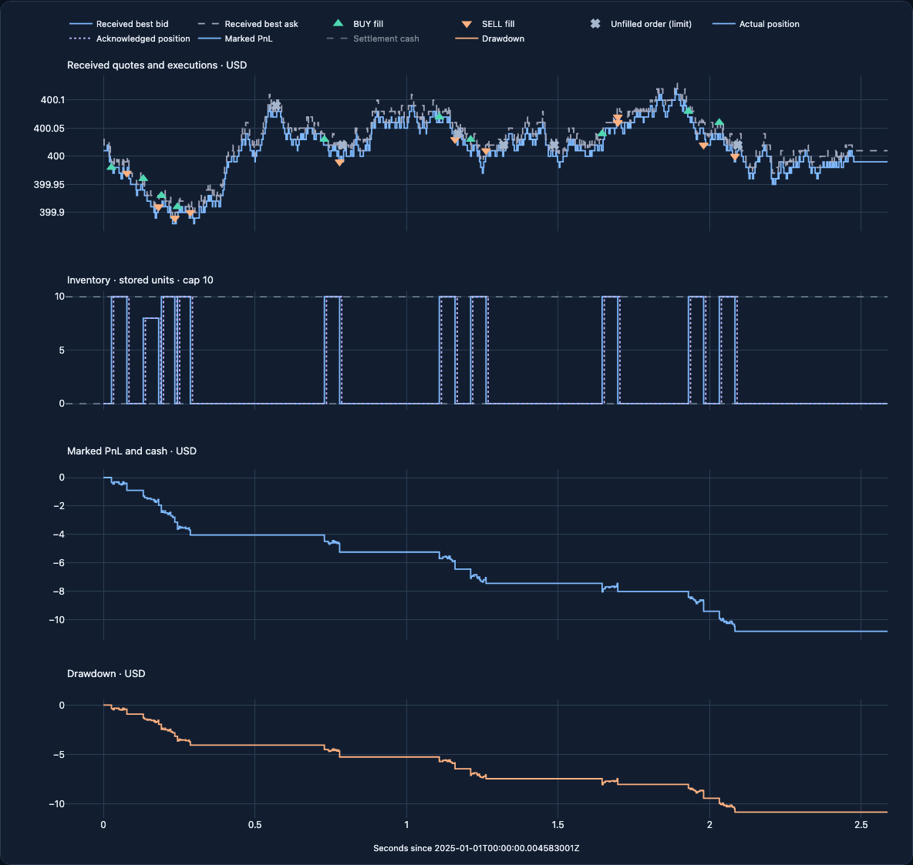

# Visualize an execution replay

The replay explorer connects received market observations, executed orders, inventory, and
settlement results in one offline HTML report. The figures use the existing execution ledger
and accounting functions. A profitable-looking price move can still produce a loss after
spread, latency, and commissions.



## Run the example

```bash
python -m pip install -e '.[interactive]'
python examples/replay_report.py --out runs/replay.html
```

Open `runs/replay.html` in a browser. The example creates invented spot, linear, and inverse
instruments with different acknowledgement delays and position limits. It has trading losses;
the demonstration illustrates execution and costs, rather than investment performance.
The adjacent `replay.html.manifest.json` records source and output hashes.

The HTML embeds Plotly.js and makes no external network requests. Expect several megabytes per
report. GitHub's Markdown renderer does not run JavaScript: use the PNG preview in a README and
generate the HTML locally. Python is needed to generate the report; viewing it needs only a browser.

Reproduce the README previews with the optional browser tooling:

```bash
python -m pip install -e '.[browser-test]'
python -m playwright install chromium
python scripts/capture_replay_report.py runs/replay.html
```

The preview manifest links each PNG to the HTML and source-data hashes. The
[light theme preview](assets/reports/replay-light.png) uses the same records and chart semantics.

## Use your own result

```python
from financeai.reporting import ReplayReportConfig, write_replay_report

# result, market, and scenario are the outputs/inputs of your run_strategy call.
artifact = write_replay_report(
    result,
    market,
    "runs/my-replay.html",
    scenario=scenario,
    config=ReplayReportConfig(
        title="Execution review",
        theme="light",
        evidence_scope="DEVELOPMENT",
        display_buckets=400,
    ),
)
print(artifact.html_path, artifact.sha256)
```

Set the evidence scope accurately: the default is `SYNTHETIC`; use `DEVELOPMENT` for
data used during strategy development, and `FRESH_TEST` for genuinely held-out evaluation.
These labels record your declared evaluation scope, not a verified performance guarantee. Existing output files are protected unless `overwrite=True` is supplied.

`build_replay_report_data(result, market, scenario=scenario)` builds the same JSON-ready data
without Plotly. The numerical core still requires only NumPy. Existing
`position_pnl_figure` and `decision_trace_figure` remain available with the `report` extra for
audited PNG/SVG figures; the interactive explorer uses the separate `interactive` extra.

## Read the four panels

| Panel | Meaning | Important distinction |
| --- | --- | --- |
| Received quotes and executions | Received best bid/ask, BUY ▲, SELL ▼, and wholly unfilled × orders | Lines show observations; fills use the book at exchange arrival. A rejected or nonmarketable order has no executed quantity. |
| Inventory | Actual position at fill arrival and acknowledged position at report receipt, with configured caps | The controller cannot act on an acknowledgement before it arrives. The lower constraint is zero when shorting is disabled. Quantities are stored integer units; instrument metadata gives their native quantity step. |
| Marked PnL and cash | Settlement cash plus inventory marked at received mid; cash can be enabled in the legend | Cash transfers that finance inventory are not profit. These are trading cash-flow values, not a funded account's equity. |
| Drawdown | Nonpositive marked PnL minus its preceding peak (including zero), in settlement currency | The card shows the largest loss as a positive magnitude. No percentage denominator or annualization is assumed. Missing marks remain gaps. |

Hover over a marker for the exact price, price ticks, requested and filled quantity, order status,
submission/arrival/acknowledgement times, and both delays. A partial order may produce several
price-level fill markers. Unfilled markers sit at the submitted limit, not an invented fill price.
The execution table shows the first 75 selected events; all selected events remain in the chart
and downloaded report data. Counts distinguish orders from price-level fills.

Selecting an instrument changes its price and position panels and initially selects its settlement
currency. The account selector always shows **all instruments in that currency**, including
instruments excluded from the price selector. Currency balances are never silently converted or
added together. `ReplayReportConfig(instruments=("venue/SYMBOL",))` restricts the selectable
execution instruments; use the exact keys from your instrument definitions.

The report reconciles fills with settlement, and checks the supplied scenario and limits. Pass the
original scenario to audit proportional and per-quantity commissions. Without it, commission
cards use the recorded settlement. Unknown limits are labeled as unknown. An invalid full account
suppresses terminal net PnL for every currency; chart paths remain available for diagnosis.

## Precision, scale, and provenance

- UTC labels and hovers retain all nine fractional digits. Epoch nanoseconds, exact quantity
  values, and integers beyond JavaScript's safe range are strings. Browser coordinates use
  seconds relative to the interval start; nearby events may share a pixel but retain distinct
  exact values in the downloaded data. PnL follows the engine's float64 accounting precision.
- Dense paths retain each time bucket's first, last, minimum, maximum, and missing-value
  boundaries. This preserves short cap excursions and drawdown extrema. Lines are stepwise;
  smoothing would invent intermediate states. Summary statistics use the complete records
  before reduction. The JSON download contains reduced paths and all selected execution events,
  not a replacement for the original tapes or complete exported ledger.
- `display_buckets`, `max_points`, and `max_events` bound browser payloads. The default limits are
  400 buckets, 200,000 path points, and 20,000 events. An exceeded limit raises a clear error;
  executions are never randomly sampled. Select fewer instruments or deliberately raise a limit.
- The manifest hashes full instrument definitions, fill/order arrays, relevant received books,
  scenario, recorded settlement, and risk limits. It also records renderer/template/metric code
  hashes, Plotly and FinanceAI versions, the reduction method, and the HTML's SHA-256 digest.
  Repeated exports with identical inputs and dependency versions produce identical HTML bytes.

Light and dark themes share labels, marker shapes, and line styles. Native labeled controls,
visible focus, a textual execution ledger, and a JSON download supplement chart hover. These
choices improve access; they are not a claim of full WCAG conformance or complete keyboard
navigation of every Plotly point.

## Design research and decisions

The following primary-source review informed this implementation. These are patterns we selected
for FinanceAI's execution model, not a feature-parity claim. Documentation was reviewed on
2026-11-02.

| Source | Established pattern | FinanceAI decision |
| --- | --- | --- |
| [NautilusTrader visualization](https://nautilustrader.io/docs/latest/concepts/visualization/) | Optional Plotly reports, self-contained HTML, declarative chart configuration, and consistent themes | Add an optional offline explorer with a typed configuration; keep numerical dependencies independent. A public chart-plugin registry can follow when several external extensions need it. |
| [vectorbt portfolio plotting](https://vectorbt.dev/api/portfolio/base/) | Selectable subplots, portfolio diagnostics, drawdown views, and custom plotting callbacks | Put execution and account diagnostics on a shared time axis. Separate summary calculations from display reduction. |
| [QuantConnect backtest analysis](https://www.quantconnect.com/docs/v2/research-environment/meta-analysis/backtest-analysis) | Analyze equity, drawdown, and backtest chart series explicitly | Name the actual cash-flow/marking quantities. Do not infer equity returns, a benchmark, or Sharpe without an account-capital model and an appropriate sampling convention. |
| [Plotly HTML export](https://plotly.com/python/interactive-html-export/) | Embedded JavaScript produces portable interactive files at a several-megabyte cost | Inline the bundle and test that file viewing makes zero external requests. Keep generated HTML out of the source repository. |
| [Plotly hover formatting](https://plotly.com/python/hover-text-and-formatting/) | Custom hover templates and auxiliary data preserve contextual information | Retain exact clock/quantity strings alongside floating display coordinates; show individual events with their own times. |
| [W3C use of color](https://www.w3.org/WAI/WCAG22/Understanding/use-of-color.html) | Meaning must have a visual cue in addition to color | Pair direction with marker shape and text, position knowledge with line style, and account validity with explicit words. |

The trade-off is a focused report rather than a general dashboard server. Future additions such as
benchmarks, return distributions, strategy comparison, and configurable panels should first define
capital, sampling, units, and alignment semantics. Adding plausible-looking ratios without those
definitions would weaken the report.

## Verification

Data regressions cover heterogeneous contracts and currencies, exact nanosecond clocks, missing
valuations, short extrema, invalid accounts, unknown limits, oversized displays, corrupt settlement,
safe label embedding, deterministic files, manifests, and optional dependency isolation.

Real Chromium checks exercise offline rendering, instrument/currency/theme controls, synchronized
zoom/reset, exact hover text, JSON download, narrow-screen overflow, and invalid/untrusted labels:

```bash
python -m pip install -e '.[dev,interactive,browser-test]'
python -m playwright install chromium
FINANCEAI_BROWSER_TESTS=1 python -m pytest -q tests/reporting/test_replay_browser.py
```

CI runs these browser checks separately from the NumPy-only and accelerated test suites. Static
figures and the [explanatory animation](trading_animation.md) retain their existing numerical checks.
